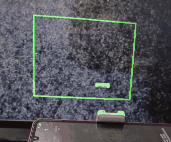
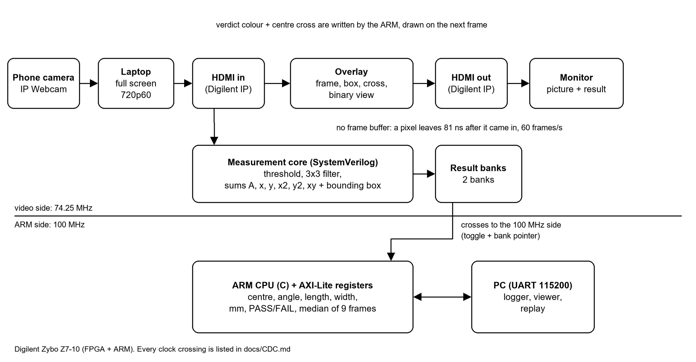
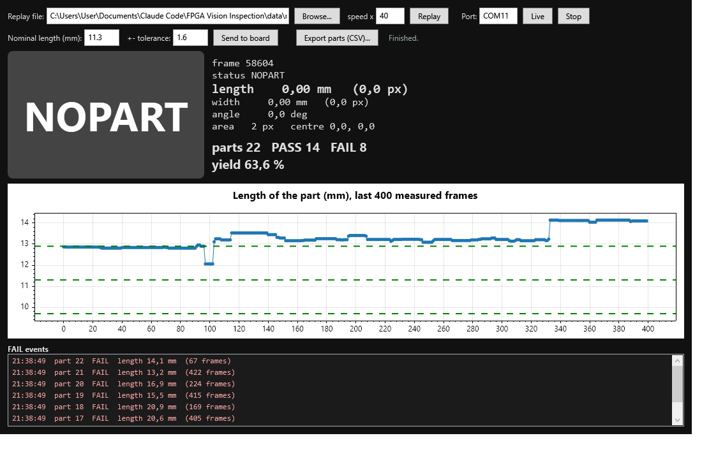

# Real-Time FPGA Vision Inspection Station

A camera looks at a small metal part on a black mat. The live video goes over HDMI into a Zybo Z7-10 board. Hardware written by hand in SystemVerilog finds the part and measures it **while the pixels stream past**, on every frame, 60 times per second. There is no frame buffer: a pixel leaves the board 81 ns after it came in. The board then says PASS or FAIL and draws the answer on the live picture: a green or red frame, a box around the part and a cross at its centre. The same numbers go to a PC over UART.

*The monitor shown by the board: empty mat, a good bolt (PASS, green), then a wrong part (FAIL, red). Cyan box = bounding box, 20 s of a 40 s recording.*

## Results

Every number was measured. [docs/RESULTS.md](docs/RESULTS.md) says how, and lists the limits.

| What | Result |
|---|---|
| Frame rate | 3,602 frames and 3,602 results in 60 s = **60.003 fps, 0 skipped** |
| Delay through the board | 6 pixel clocks = 81 ns (by design) |
| Hardware vs Python model | **20 / 20 recorded frames bit-exact on the real board**; 13 / 13 simulation cases bit-exact (285 + 285 real frames, edge cases, maximum-value frames) |
| Repeatability (bolt not touched, 3 positions, about 530 results each) | length std **0.057 to 0.073 mm** |
| PASS/FAIL (5 good bolts, 4 other part types, 3 placements each) | good: **15 / 15 PASS**. bad: **11 / 12 FAIL**, none wrongly passed. Per frame: good PASS 97.4 %, bad FAIL 92.8 % |
| Size | 2,197 LUTs (12.5 %), 2,655 flip-flops, 0.5 block RAM, 3 DSPs on the small XC7Z010 |
| Timing | met on all clocks: worst setup slack +1.060 ns, hold +0.033 ns |

## How it works

1. **HDMI in.** Digilent's `dvi2rgb` turns the laptop's HDMI into pixels. A custom EDID makes the laptop send only 1280x720 at 60 Hz. The laptop shows the phone camera (IP Webcam) full screen.
2. **Measurement core** (`rtl/meas_core.sv`, 74.25 MHz). For every pixel inside the inspection window: gray value, threshold (bright part on dark mat), a 3x3 majority filter that removes single specks (two row buffers), and running sums: the number of part pixels, the sums of x, y, x², y², x·y (DSP multipliers), and the bounding box.
3. **Result banks.** When the window of a frame is finished, the sums are written into one of two banks. The ARM reads the other one, so it never sees a half-written result. How the banks cross to the 100 MHz clock is in [docs/CDC.md](docs/CDC.md).
4. **ARM program** (`sw/inspect`, bare-metal C). Once per frame it turns the sums into the centre, the angle, the length and width (an equivalent rectangle, exact for solid rectangles), then into millimetres with a calibration, takes the median of the last 9 frames and decides PASS/FAIL against a length and width tolerance. It writes the verdict colour and the centre back to the overlay, and sends one text line per frame over UART ([docs/PROTOCOL.md](docs/PROTOCOL.md)).
5. **Overlay** (`rtl/insp_overlay.sv`). Window frame (white / green / red / yellow), bounding box, centre cross, and a switch for the binary view ("what the FPGA sees"). Results of frame N are drawn on frame N+1.

The split is deliberate: the FPGA does every per-pixel operation (55 million pixels per second); the ARM only does about twenty operations per frame (divisions, square roots, atan2).

## How it was checked

- **One specification**: [docs/MEASUREMENT.md](docs/MEASUREMENT.md) gives the exact integer maths. `py/golden.py` follows it, and `py/check_opencv.py` compares it with OpenCV (threshold, filter, moments, bounding box, histogram) on all recorded frames. Three planted bugs were each caught.
- **Bit-exact simulation**: the RTL is compared with the golden model on the real recorded camera frames and on edge cases (1x1 window, full frame, settings that change exactly at the start of a frame, blanking of 1 clock, synthetic all-white frames that reach every accumulator's maximum).
- **On the board**: recorded frames are shown on the HDMI input and every result line must equal the golden model (20 / 20).
- **Review**: a read-only review of the RTL found one real bug (a bank pointer that could be one frame stale after a reset on the ARM side). It was fixed and a test was added that fails on the old design.

## PC operator app (C#, WPF)

`pc/InspectionApp` shows the live result of the board over the serial port, or **replays a recorded CSV** (no board needed): a big PASS/FAIL tile, the numbers, a count of parts and the yield, a trend chart of the length with the tolerance band, a list of FAIL events, and a CSV export. A Python version with the same logic is `py/viewer.py`. 17 xUnit tests cover the line parser, the part counting, the view model (with a fake serial port) and a replay of the real evidence, which must give exactly the same counts as the Python version (22 parts, PASS 14, FAIL 8). Build and test: `cd pc; dotnet test`. Start a replay: `InspectionApp.exe --replay ..\data
uns‚61020_final.csv --speed 40`. Sending settings to the live board (command `n`) could only be tested with a fake port, because the board was returned before the app was finished.

## PLC link (software)

[docs/PLC.md](docs/PLC.md): a vision gateway publishes the results as **Modbus TCP** registers (counts, last verdict, length, yield, heartbeat), and a simulated PLC scan loop reads them, counts good and bad parts, pulses a reject output on every FAIL and latches a line-stop alarm after 3 FAIL parts in a row. The Modbus code is written by hand and checked against the independent `pymodbus` library; 30 checks run the whole chain on the real recorded board results (22 parts, PASS 14, FAIL 8, one reject pulse per FAIL, the counters of the simulated PLC equal those of the gateway). It is a **simulation**: no real PLC or OpenPLC was used, and it was not run with the live board.

## AI layer

The measuring core is classic on purpose (exact numbers you can check with a ruler). On top of it, [docs/AI.md](docs/AI.md) tests a small learned model on the measured features, using only real board results. Telling the 5 part types apart (leave-one-recording-out): decision tree **86.2 %** of frames, 25 of 30 recordings. Rejecting defects it has **never seen**, trained on good bolts only: **98.7 %** of good frames accepted and **100 %** of bad frames rejected, but a plain tolerance rule fitted on the same data does almost as well (99.5 % / 99.0 %). So the AI is not better than the rule here; its benefit is that it needs no hand-set tolerance. Nothing from the AI layer was run on the board.

## What was hard

- **Light.** The phone changes its brightness by itself, and a fixed threshold stops working (the same black mat was gray 18 in one session and gray 50 in another). The exposure is locked on the phone, and the measured length still depends on the threshold (11.98 mm at T=120 against 10.27 mm at T=160 for the same bolt), so the calibration is done at the threshold that is used.
- **A second "part".** In one recording the mouse pointer rested on the board's screen. Windows sends it in the HDMI video, so the hardware counted it as an object. Found with a live check, fixed by parking the pointer.
- **Flickering specks.** Bright specks of mat fluff flicker in the live camera picture and spoiled the second moments (a few pixels far away change the length a lot). The 3x3 filter and a median over the last frames fixed it. My first version of the median reset itself on every noisy frame and left the board undecided 75 % of the time; a live comparison with and without smoothing showed it.
- **Shiny metal.** A shiny bolt is a bright stripe with dark edges, so the measured width is the stripe, and the measured length of long parts changes by several mm with the angle.

## Limits

- The PASS/FAIL rule was tuned on an earlier recording of the same parts and then tested on a new one: not a blind test.
- No caliper: the reference is a ruler (+-1 mm) and the calibration is +-2 %. Accuracy against a caliper was **not** measured.
- One part at a time, one camera, one lamp, one background.
- Power (2.0 W) is Vivado's estimate and the 81 ns delay is by design, not measured.
- The SD-card boot was not tested (no SD card was available); `BOOT.bin` was built but never run.
- CDC: five critical findings in Vivado's report are inside Digilent's `dvi2rgb` IP, none in my logic. The synchronized paths have no `set_max_delay` constraint ([docs/CDC.md](docs/CDC.md)).

## Repository

| Folder | Contents |
|---|---|
| `rtl/` | SystemVerilog: measurement core, banks, overlay, AXI-Lite registers, top level (`rtl/reuse/` holds unused modules from the previous project) |
| `tb/`, `scripts/sim_*.py` | self-checking testbenches and the bit-exact simulation against the golden model |
| `sw/inspect/`, `sw/common/` | ARM program and register map; `sw/test` the PC test of the C maths |
| `py/` | golden model, OpenCV check, UART logger, evidence recording and analysis tools, Python viewer with replay, AI evaluation, Modbus TCP gateway and simulated PLC |
| `pc/` | C# WPF operator app (live serial or replay, PASS/FAIL tile, yield, trend chart with tolerance band, FAIL log, CSV export) with 17 xUnit tests |
| `docs/` | `MEASUREMENT.md` (spec), `REGISTERS.md`, `PROTOCOL.md`, `CDC.md`, `RESULTS.md`, `LEARNING.md`, `reports/` (timing, utilization, power) |
| `data/` | a few photos and video stills; the 285 + 168 recorded frames and the 87 MB demo video stay outside git |

Parts of the HDMI pipeline, the clock-crossing blocks and the build scripts are adapted from my earlier project [FPGA-Edge-AI-Video](https://github.com/alvinhdr/FPGA-Edge-AI-Video). The Digilent `vivado-library` is a git submodule pinned to commit `f4613ff`.

License: MIT.
